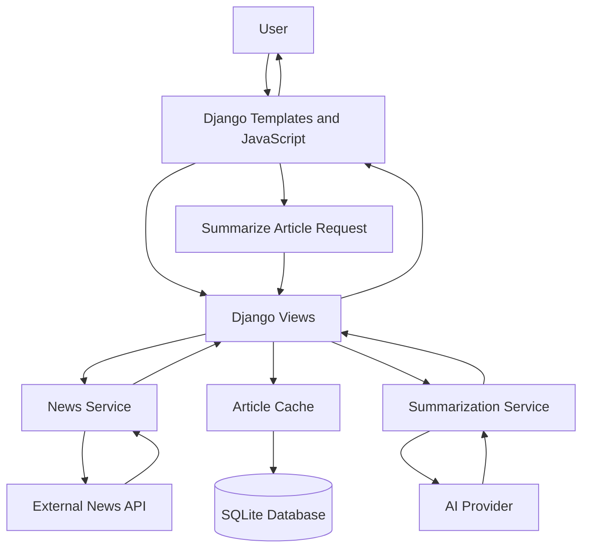

# NewsMind — System Architecture

## 1. Overview

NewsMind is a Django-based news application designed to retrieve news articles and provide AI-generated summaries. It combines a web interface, external news services, AI summarization, and database-backed article caching.

## 2. High-Level Architecture

## 3. Technology Stack

- **Backend:** Python and Django
- **Frontend:** HTML, CSS, JavaScript, and Django templates
- **Database:** SQLite
- **News retrieval:** External news API
- **AI summarization:** Configured AI provider
- **Configuration:** Environment variables loaded through `python-dotenv`

## 4. Main Components

### Django Views

Handle incoming requests, coordinate the news and summarization services, and return rendered pages or responses to frontend requests.

### News Service

Retrieves news articles from the configured external news provider.

### Summarization Service

Sends article content to the configured AI provider and returns a generated summary when the request succeeds.

### Article Cache

The `CachedArticle` model stores article information, including:

- Headline
- Source
- Original article URL
- AI summary
- Category
- Fetch timestamp

### Database

SQLite stores cached article records. The database file used during local development should not be committed to the repository.

### Frontend

Django templates, CSS, and JavaScript display news articles and handle user interactions, including summary requests.

## 5. Request Flow

1. The user opens NewsMind or searches for news.
2. Django views request articles from the news service.
3. The news service communicates with the configured news API.
4. Article data is returned to the views and displayed on the page.
5. When the user requests an AI summary, Django calls the summarization service.
6. The summarization service communicates with the configured AI provider.
7. The generated summary is returned to the frontend when successful.
8. Cached article data may be reused according to the application's caching logic.

## 6. Configuration and Security

- Keep API keys and Django's secret key in a local `.env` file.
- Do not commit `.env`, database files, or other secrets to GitHub.
- Provide an `.env.example` containing variable names and placeholder values only.
- Set `DEBUG=False` for production deployments.
- Configure `ALLOWED_HOSTS` and production security settings before deployment.

## 7. Current Limitations

Documented limitations should reflect the current implementation. External API availability, missing article images, AI-provider failures, and cache behavior can affect the user experience.

## 8. Future Improvements

- Add automated tests for news retrieval and summarization.
- Improve error handling and request timeouts.
- Add persistent caching and pagination.
- Improve article image fallbacks.
- Configure production deployment and monitoring.
